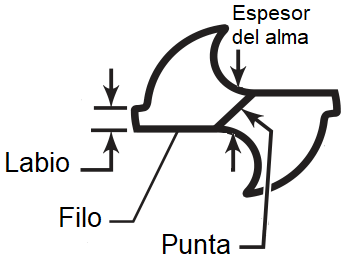
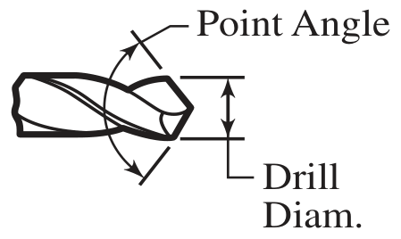

<!-- *** GUIDE START *** -->

### Geometría de la mecha o broca

La broca helicoidal tiene dos filos principales simétricos y un **alma central** (el núcleo grueso que los une) que le da rigidez y guía el avance desde el centro. Cuando se perfora el alma central realmente no corta al material, simplemente lo aplasta y lo desplaza.

::: figure
{width=300px}
<small>Filo y otras partes</small>
:::

También la punta tiene un ángulo que puede variar según el material que se perfora. Una mecha para propósitos generales, como acero blando (nuestro martillo), debería tener 118°:

::: figure
{width=300px}
<small>Ángulo de la punta (point angle)</small>
:::

### Método correcto para agujeros grandes en acero blando

Marcar firmemente con un punto de marcar y perforar **directamente al diámetro final**, evitando pasos intermedios que desestabilizan el corte y provocan vibraciones. Refrigerar siempre. Si la viruta sale enrulada significa que la mecha está afilada y estamos trabajando correctamente.

### Actividad

::: activity

Dibujar la segunda figura pero marcando ambos filos y poniendo nombre a los otros elemntos.

Explicar oralmente al profesor la geometría de una mecha y como se agujerea correctamente.

:::

<!-- *** GUIDE END *** -->

<!-- *** GUIDE AUXILIARY THINGS *** -->

<!--

● Sections: example, activity. solutions, figure, warning, note

::: example
### Ejemplo: Cálculo de derivadas
Aquí va el contenido de tu ejemplo. Puedes usar Markdown normal adentro.
:::

● Image:

::: figure
{width=400px}

<small>Pie (Source)</small>
:::

[⌕](../../images/ ) 

● Videos:

 Change XXX to video-id and put time in seconds

 - Yotube with start point: [Mira este momento clave en el video](https://www.youtube.com/watch?v=XXX&t=123s)

 - Youtubetrimmer with start and end point: [Mirá este momento puntual del video](https://youtubetrimmer.com/view/?v=XXX&start=120&end=150&loop=0)

-->
