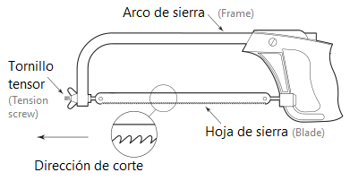
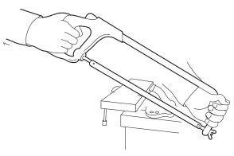
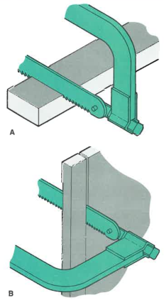

<!-- *** GUIDE START *** -->

### Partes principales y montaje de la hoja

La sierra manual es una herramienta para cortar metales, plásticos o madera, dependiendo del tipo de hoja.

En la figura puedes observar sus partes principales y la dirección en que apuntan los dientes cuando está colocada en el arco:

::: figure
{width=400px}

<small>Partes principales</small>
:::

**Versión en inglés**

The hacksaw is a tool used for cutting metal, plastic, or wood, depending on the type of blade.

As shown in the figure, its main parts are:

* Frame
* Tension screw
* Blade

(figure)

The figure also shows the direction in which the teeth should point when mounted on the frame.

### Selección de la hoja

En la selección de una hoja de sierra manual el factor más determinante es la cantidad y tamaño de los dientes. Esto se mide en "cantidad de dientes por pulgada", también llamado TPI (Teeth Per Inch = dientes por pulgada).

**Relación material - cantidad de dientes por pulgada (TPI):**

* **Materiales blandos (aluminio, cobre, plásticos):** hojas de **18 TPI** (dientes grandes, corte rápido).
* **Acero medio y bronce:** hojas de **24 TPI** (equilibrio entre rapidez y prolijidad).
* **Acero duro o piezas delgadas:** hojas de **32 TPI** (dientes pequeños, corte fino y preciso).

> Regla práctica: 
>
> - A mayor dureza del material y menor espesor, mayor cantidad de dientes por pulgada.
> - Si hay que comprar una hoja para propósitos generales comprar una de **24 TPI**

### Tips de uso

Para usarla correctamente y con seguridad hay que: 

* Marcar la línea de corte con punta de marcar.
* Sujetar la pieza en la morsa.
* Ejercer presión mayormente al avanzar. En el retroceso la presión puede ser menor o ninguna.
* Ajustar el tornillo tensor hasta que la hoja quede suficientemente tensa sin excederse para evitar dañar la rosca.

Abajo se muestran algunos otros tips:

::: figure
{width=300px}
<small>Se agarra con ambas manos</small>
:::

::: figure
{width=150px}

<small>Girar la hoja si el corte es largo</small>
:::

### Actividad

::: activity

**a)** Dibujar una sierra señalando sus partes principales y la dirección de los dientes

**b)** Escribir la cantidad de dientes por pulgadas que tendría la sierra ideal para cortar la barra del martillo.

**c)** Explicar oralmente como se desarma y arma un sierra y la precausión al tensar la hoja.
:::

---

::: note
**Algunas fuentes usadas**

- Timings, R. (2008). Fabrication and Welding Engineering. Elsevier.
- Walker, J.R. (2000). Machining Fundamentals. Goodheart-Willcox Company.
:::
<!-- *** GUIDE END *** -->

<!-- *** GUIDE AUXILIARY THINGS *** -->

<!--

● Sections: example, activity. solutions, figure, warning, note

::: example
### Ejemplo: Cálculo de derivadas
Aquí va el contenido de tu ejemplo. Puedes usar Markdown normal adentro.
:::

● Image:

::: figure
{width=400px}

<small>Pie (Source)</small>
:::

[⌕](../../images/ ) 

● Videos:

 Change XXX to video-id and put time in seconds

 - Yotube with start point: [Mira este momento clave en el video](https://www.youtube.com/watch?v=XXX&t=123s)

 - Youtubetrimmer with start and end point: [Mirá este momento puntual del video](https://youtubetrimmer.com/view/?v=XXX&start=120&end=150&loop=0)

-->
